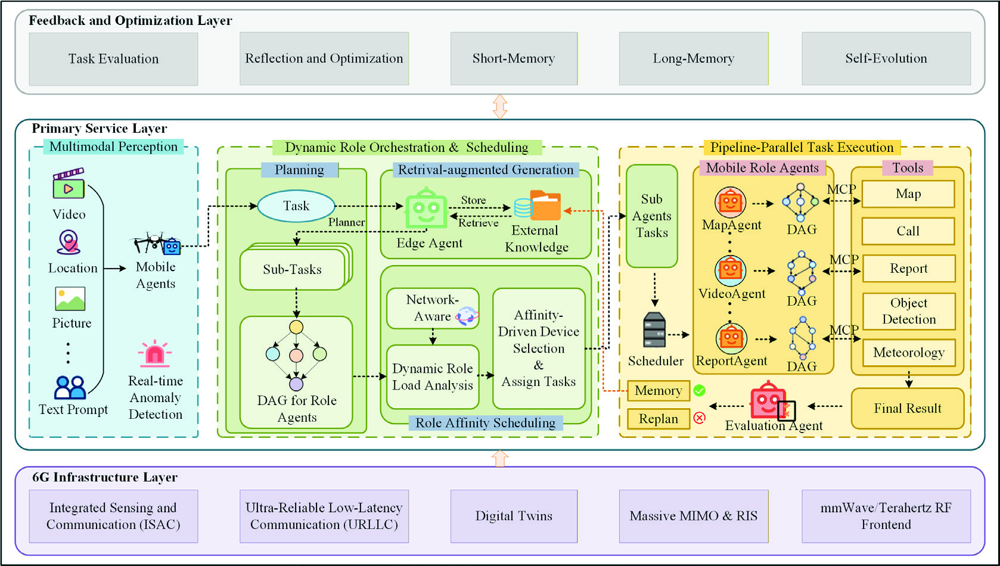
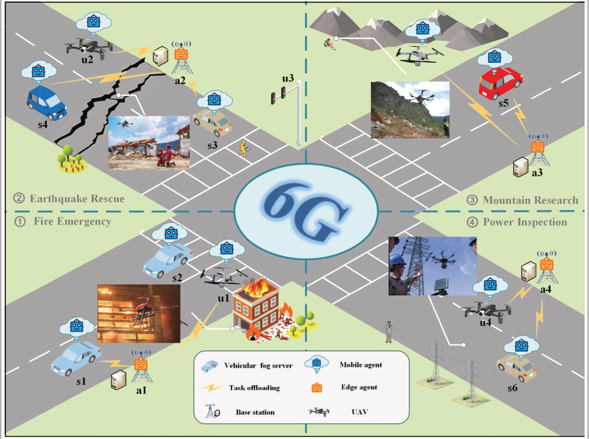
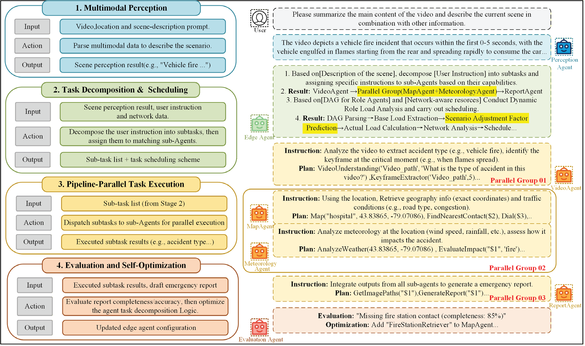
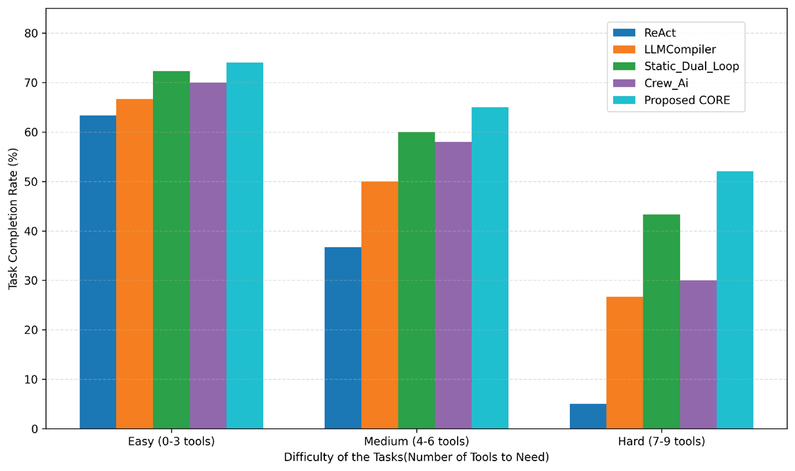
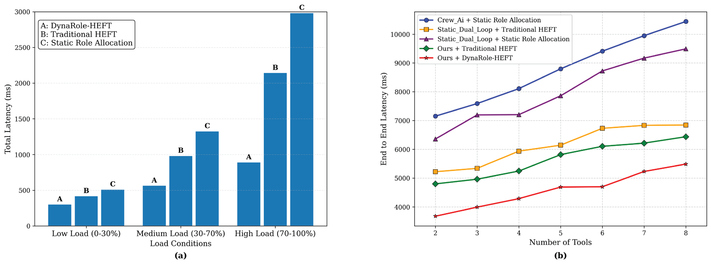
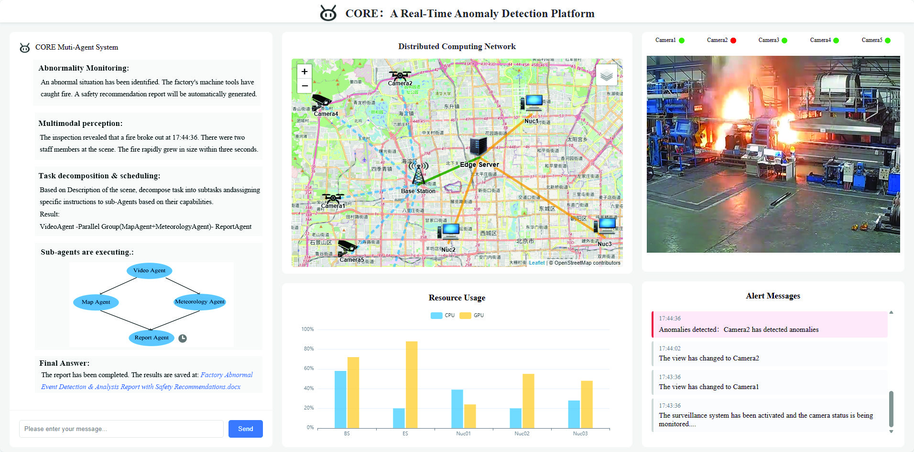

<div align="center">

# CORE: Toward Ubiquitous 6G Intelligence Through Collaborative<br>Orchestration of Large Language Model Agents Over Hierarchical Edge

**Zitong Yu**<sup>1</sup> &nbsp;
**Boquan Sun**<sup>1</sup> &nbsp;
**Yang Li**<sup>1</sup> &nbsp;
**Zheyan Qu**<sup>1</sup> &nbsp;
**Xing Zhang**<sup>1†</sup>

<sup>1</sup>Beijing University of Posts and Telecommunications, Beijing, China

<sup>†</sup>Corresponding author

[](https://doi.org/10.1109/MCOM.001.2500469)


</div>

<p align="center">
  
</p>

<p align="center"><em>
Fig. 2. The three-layer CORE architecture. A feedback and optimization layer supports evaluation, memory, and self-evolution; the primary service layer integrates multimodal perception, dynamic role orchestration and scheduling, and pipeline-parallel tool execution; and the 6G infrastructure layer supplies sensing, communication, and computation capabilities.
</em></p>

## News

- **2026-05**: CORE was published in *IEEE Communications Magazine*, Vol. 64, No. 5, pp. 28–34. [Paper / DOI](https://doi.org/10.1109/MCOM.001.2500469).

## Highlights

Ubiquitous intelligence in 6G depends on AI agents operating across mobile devices, edge servers, and cloud infrastructure. Yet their computing resources are fragmented and heterogeneous: centralized LLM processing may introduce excessive network latency, while a single resource-constrained device may be unable to handle complex reasoning. We present **Collaborative Orchestration Role at Edge (CORE)**, a collaborative, role-based LLM-agent framework designed to exploit hierarchical edge resources for more efficient task execution.

- **Distributed, specialized LLM agents.** CORE places agents with distinct functional roles across mobile devices and tiered edge servers. Complex requests are decomposed into manageable subtasks and assigned to agents according to their capabilities and available resources.
- **Three complementary optimization mechanisms.** Real-time multimodal perception identifies context and anomalies; dynamic role orchestration organizes and assigns work; and pipeline-parallel execution accelerates dependent tool workflows using directed acyclic graphs (DAGs) and the Model Context Protocol (MCP).
- **Role-affinity scheduling and practical validation.** CORE matches task demands to device and network conditions through role-affinity scheduling. Evaluations on emergency-related tasks, together with a real edge-computing deployment, show improved task completion and lower latency relative to evaluated baselines.

## How it works

### From heterogeneous 6G devices to collaborative intelligence

<p align="center">
  
</p>

<p align="center"><em>
Fig. 1. Examples of multi-agent intelligence over 6G, including earthquake rescue, fire emergency response, mountain research, and power inspection. Mobile agents, edge agents, UAVs, and other nodes share tasks over the network.
</em></p>

CORE has **three architectural layers**, as illustrated by the framework figure at the top of this README:

- **Feedback and Optimization Layer.** Task evaluation, reflection and optimization, short-term memory, long-term memory, and self-evolution preserve useful experience and support iterative improvements to the orchestration process.
- **Primary Service Layer.** Multimodal perception, dynamic role orchestration and scheduling, retrieval-augmented generation, and pipeline-parallel task execution implement the main agent workflow.
- **6G Infrastructure Layer.** Underlying 6G capabilities—including integrated sensing and communication (ISAC), ultra-reliable low-latency communication (URLLC), digital twins, massive MIMO / reconfigurable intelligent surfaces (RIS), and millimeter-wave / terahertz systems—support distributed sensing and communication.

**Multimodal perception.** Mobile agents process input such as video, images, locations, and text. They extract scene information, recognize abnormal events, and transform observations into actionable descriptions or instructions for downstream agents.

**Task decomposition and dynamic role orchestration.** An edge-side orchestration agent decomposes a request into subtasks, organizes their dependencies, and selects appropriate specialized roles—such as VideoAgent, MapAgent, MeteorologyAgent, and ReportAgent. Retrieval-augmented generation enables the orchestrator to consult external knowledge as tasks are planned.

**Role-affinity scheduling.** CORE considers task complexity, data volume, timing requirements, network bandwidth and latency, reliability, and the compute, memory, and energy characteristics of candidate devices. Its scheduling mechanism aims to place compute-heavy operations on suitable edge servers while preserving lightweight operations near their data sources. It also supports reassignment when resources become overloaded. The paper discusses using historical data and offline digital-twin simulations to guide latency-sensitive scheduling decisions without costly online simulation in every decision cycle.

**Pipeline-parallel execution with MCP.** A task graph encodes which operations depend on one another, allowing independent subtasks and tool calls to run concurrently. DAGs specify execution dependencies, while MCP supports context exchange and tool integration across heterogeneous agents and services.

**Evaluation and feedback.** After execution, the evaluation agent checks the results, triggers replanning when needed, and feeds the outcome back into memory and optimization components.

## Case study: emergency-response orchestration

<p align="center">
  
</p>

<p align="center"><em>
Fig. 3. A vehicle-fire incident is handled through multimodal perception, task decomposition and scheduling, pipeline-parallel execution by specialized agents, and final evaluation and optimization.
</em></p>

A video-based vehicle-fire alert provides an example of CORE's end-to-end workflow. The perception agent interprets the scene; the edge orchestrator determines the required response; and specialized agents analyze the video, retrieve geographical and traffic information, evaluate local weather conditions, and assemble an emergency report. Independent work can be performed in parallel before the final report is generated. The evaluation stage can flag missing information and send an affected step back for correction.

## Performance evaluation

The paper evaluates **task completion rate** and **latency**. Its task set uses an open-source fire / fire-gas video dataset and 300 task instructions generated with a large language model and manually curated. The difficulty tiers are defined by the number of tools required: **Easy (0–3), Medium (4–6), and Hard (7–9)**. Baselines include the single-agent methods **ReAct** and **LLMCompiler** and multi-agent alternatives **Static_Dual_Loop** and **Crew_Ai**.

### Higher task completion rate

<p align="center">
  
</p>

<p align="center"><em>
Fig. 4. Task completion rate comparison across task difficulties. CORE achieves the highest rate at each difficulty level in the reported evaluation.
</em></p>

| Scheme | Easy (0–3 tools) | Medium (4–6 tools) | Hard (7–9 tools) |
|---|---:|---:|---:|
| ReAct | ≈63% | ≈37% | ≈5% |
| LLMCompiler | ≈67% | ≈50% | ≈27% |
| Static_Dual_Loop | ≈73% | ≈60% | ≈43% |
| Crew_Ai | ≈70% | ≈58% | ≈30% |
| **Proposed CORE** | **≈75%** | **≈65%** | **≈52%** |

*Percentages are approximate visual readings of Fig. 4, not exact values from a published numerical table.*

Task completion declines as tasks require more tools, but CORE maintains a lead over the compared approaches. The authors attribute this improvement to dynamic task decomposition, specialized agents, and adaptive role scheduling rather than a fixed arrangement of roles.

### Lower scheduling and end-to-end latency

<p align="center">
  
</p>

<p align="center"><em>
Fig. 6. (a) Total latency under low, medium, and high workload conditions for DynaRole-HEFT, traditional HEFT, and static allocation. (b) End-to-end latency versus the number of tools for CORE and alternative role/scheduling combinations.
</em></p>

The paper reports that **DynaRole-HEFT**—the role-aware scheduling approach used with CORE—reduces high-load latency by **52% relative to traditional HEFT**. Across workflows involving two to eight tools, **CORE + DynaRole-HEFT** also records the lowest end-to-end latency among the plotted strategies. Parallel task execution and affinity-aware resource placement contribute to the difference. At the same time, the paper notes that orchestrator inference remains a nontrivial source of delay.

### Real-world deployment

<p align="center">
  
</p>

<p align="center"><em>
Fig. 5. The CORE real-time anomaly-detection platform brings together distributed-network monitoring, multimodal video analysis, role-agent execution, resource utilization, and alert messages.
</em></p>

The reported deployment uses **DeepSeek-R1-Distill-Llama-70B** for orchestration on **eight NVIDIA A40 GPUs (48 GB VRAM each)**. At the edge, **MiniCPM-v2.6 (8B)** runs on systems equipped with **NVIDIA RTX 3090 and RTX 4090 GPUs**. MCP supports information exchange and tool coordination across the deployment. The platform demonstrates how CORE integrates video-event analysis, agent task execution, and network-resource monitoring in an operational setting.

## Beyond the case study

The architecture targets a wider range of 6G-enabled settings, including smart-city monitoring, industrial automation, healthcare, and space–air–ground communications. These are application opportunities discussed in the paper, not separate experimentally validated deployments of CORE in every domain.

## Open challenges and future directions

- **LLM inference versus strict real-time requirements.** Some URLLC applications demand sub-millisecond response times, whereas LLM inference is far slower. The paper advocates a hybrid approach in which LLMs provide higher-level decisions while lightweight, predictable components handle immediate safety-critical control.
- **Scheduling overhead.** Orchestrator inference is reported at approximately **180–320 ms**, accounting for a substantial share of delay under high-load conditions. Lightweight schedulers and model specialization remain important research directions.
- **Heterogeneous-device constraints.** Memory capacity, computational power, energy consumption, and variable network conditions complicate role placement and generalization to additional hardware.
- **Reliability and interoperability.** Inconsistent agent outputs, inter-node synchronization, heterogeneous APIs, and cross-device communication can introduce failures. More robust coordination and standardized interfaces remain necessary.
- **Scaling and network integration.** The paper identifies model distillation, tighter coupling with 6G network slicing, improved scheduling strategies, and stronger communication standardization as directions for future work.

## Copyright

© 2026 IEEE. The research figures included here were extracted from the user-provided paper for this research README. The publication and its figures remain subject to the publisher's applicable copyright and reuse permissions.

## Acknowledgment

This work was supported by the **National Science Foundation of China**, Grant **62271062**.

## Citation

If you find this work useful, please cite:

```bibtex
@article{yu2026core,
  title   = {CORE: Toward Ubiquitous 6G Intelligence Through Collaborative Orchestration of Large Language Model Agents Over Hierarchical Edge},
  author  = {Yu, Zitong and Sun, Boquan and Li, Yang and Qu, Zheyan and Zhang, Xing},
  journal = {IEEE Communications Magazine},
  volume  = {64},
  number  = {5},
  pages   = {28--34},
  month   = {May},
  year    = {2026},
  doi     = {10.1109/MCOM.001.2500469}
}
```

## Contact

For correspondence about this work, please contact **Xing Zhang** (zhangx@ieee.org), or the first author **Zitong Yu** (yztong@bupt.edu.cn).
